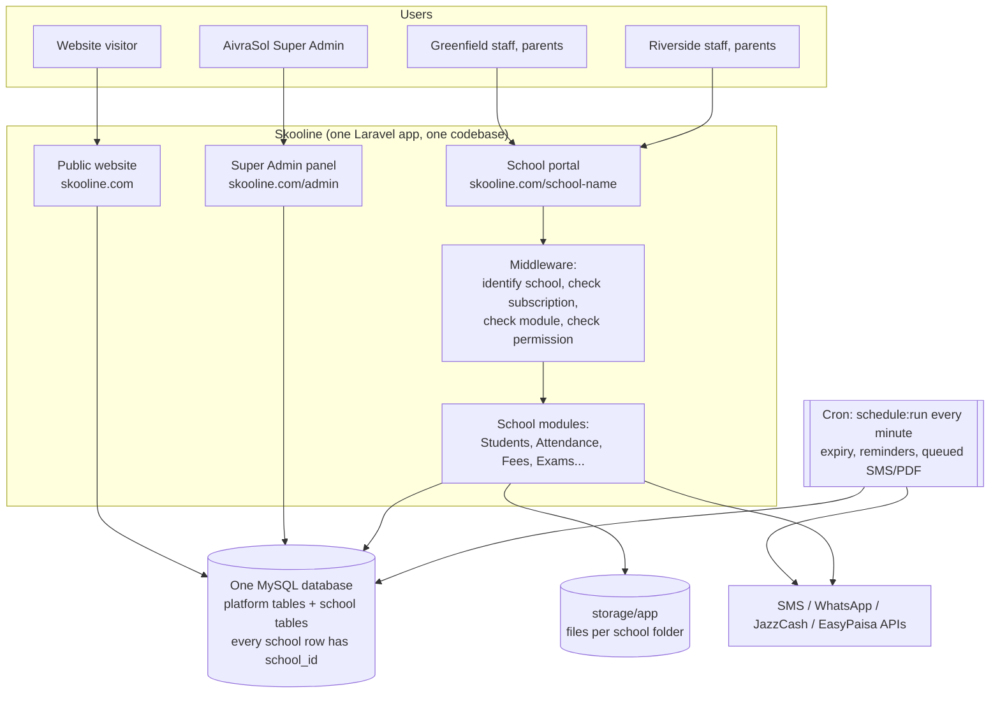
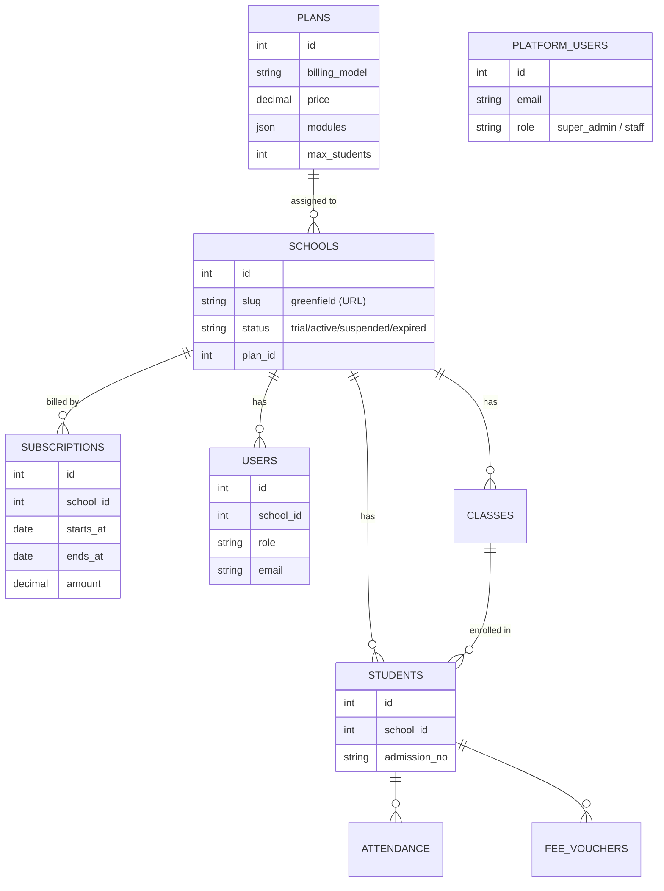
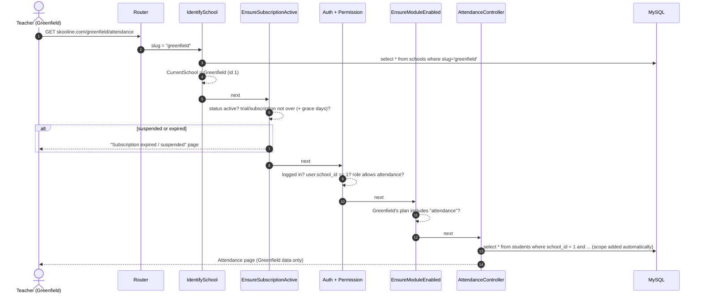
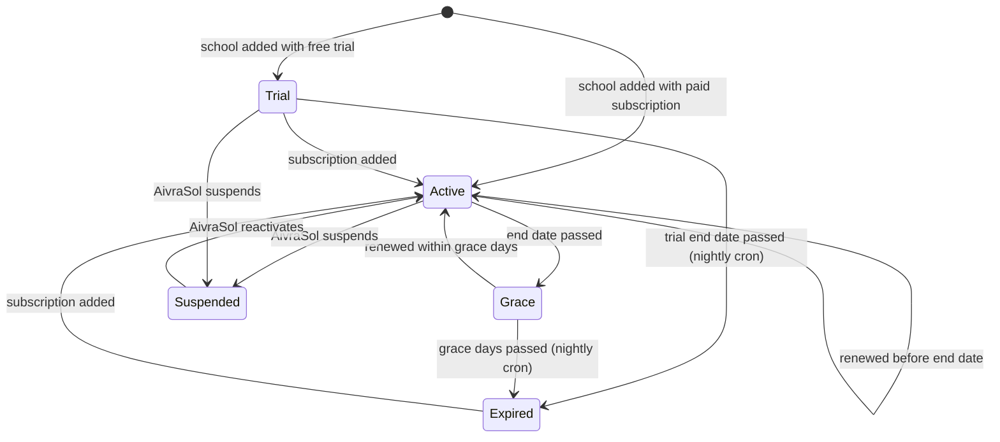

# Skooline — System Architecture

> **Goal:** one Skooline installation serves many schools. Each school sees only its own data.
> The same code must run **unchanged** on **localhost**, **cPanel / hPanel shared hosting**, and a **VPS**.

---

## 1. Hosting rules (apply to every feature from now on)

Shared hosting (cPanel / hPanel) has limits. Skooline is designed around them, so it runs anywhere.

| Shared hosting limit | Rule in Skooline |
|---|---|
| Databases are created by hand in the panel; code usually **can't** run `CREATE DATABASE` | **One MySQL database for the whole platform.** Every school row carries a `school_id`. |
| Wildcard subdomains / wildcard SSL often unavailable | Every school works on a **path URL** (`skooline.com/greenfield`). A subdomain (`greenfield.skooline.com`) is optional and maps to the same school. |
| No Node.js on the server | Compiled CSS/JS is committed in `public/build`. |
| No Redis, no Supervisor, no long-running workers | Queue, cache and sessions use the **database** driver. **One cron job** (`schedule:run` every minute) runs the scheduled tasks and works through the queue. |
| No Chromium / headless browser | PDFs (vouchers, report cards, ID cards) use **DomPDF** (pure PHP). |
| `symlink()` often disabled | Uploaded files are stored privately in `storage/app` and served through an authorised download route. No `storage:link` needed. |
| SSH not always available | A **web installer** (`/install`) and a release ZIP that already contains `vendor/` (planned), so setup can be done from the File Manager. |
| Document root fixed to `public_html` | Root `.htaccess` forwards every request to `public/` (already in place). |
| Only common PHP extensions | Only standard extensions are used: `pdo_mysql`, `mbstring`, `openssl`, `gd`, `zip`, `intl`, `fileinfo`. |
| Outgoing email via the host's SMTP | Mail uses SMTP settings from `.env`. |

The same code on a VPS can switch to Redis, a real queue worker, S3 storage and wildcard subdomains by changing `.env` only, with no code change.

---

## 2. Big picture



### Three areas in one app
| Area | URL | Who uses it | Data it touches |
|---|---|---|---|
| **Website** | `skooline.com` | Visitors | Plans (read), demo requests |
| **Super Admin** | `skooline.com/admin` | AivraSol team | All platform tables, plus a read-only summary of every school |
| **School portal** | `skooline.com/{school}` (or `{school}.skooline.com`) | Principal, admin, staff, teachers, students, parents | **Only rows of that school** |

---

## 3. Data model: one database, separated by `school_id`



**Two kinds of tables:**
1. **Platform tables** (no `school_id`): `platform_users`, `plans`, `schools`, `subscriptions`, `demo_requests`. Only the Super Admin panel writes them.
2. **School tables** (every one has `school_id`): `users`, `academic_sessions`, `classes`, `sections`, `subjects`, `students`, `guardians`, `attendance`, `fee_vouchers`, `payments`, `exams`, `marks`, and so on.

### How isolation is guaranteed (not left to each developer)
1. **`BelongsToSchool` trait on every school model.** It adds a global scope `where school_id = current school`, and it fills `school_id` automatically when a row is created.
2. **The current school is set once per request** by middleware, from the URL. Nothing else can change it.
3. **Unique rules include the school**, e.g. `unique(school_id, admission_no)`. So Greenfield and Riverside can both have admission no. `1001`.
4. **Route model binding is scoped.** `/riverside/students/57` returns 404 if student 57 belongs to Greenfield.
5. **Indexes start with `school_id`** on every school table, so queries stay fast as data grows.
6. **Isolation tests** for every module: data created in school A must never appear in school B.
7. **Files** are stored under `storage/app/schools/{school_id}/...` and downloaded only through an authorised route.

---

## 4. Request flow (what happens on every page)



---

## 5. Worked example: two schools subscribe

### Day 1: AivraSol sets up plans (Super Admin)
| Plan | Billing | Price | Modules |
|---|---|---|---|
| Starter | Monthly | PKR 4,000 | Students, Attendance, Fees, Exams, SMS |
| Standard | Per student | PKR 50 / student / month | Starter + Timetable, HR & Payroll, Accounts, Library |
| Premium | Yearly | PKR 150,000 | Everything (incl. Transport, Hostel, AI) |

### Day 2: Greenfield Grammar School, Lahore (820 students)
1. Fills the **demo form** on the website. It appears in Super Admin → Demo Requests.
2. AivraSol clicks **Add school**: name, URL `greenfield`, plan **Standard**, paid subscription, 820 students.
3. Skooline does all of this in **one database transaction**:
   - Inserts `schools` row: **id = 1**, slug `greenfield`, status `active`, plan Standard.
   - Inserts `subscriptions` row: 01 Nov – 30 Nov, amount 820 × 50 = **PKR 41,000**.
   - Creates the school admin `users` row with **school_id = 1**.
   - Seeds defaults with **school_id = 1**: academic session 2026-27, default roles (Principal, Admin, Accountant, Teacher, Parent), grading scale, fee heads.
4. AivraSol sends the school its login: `skooline.com/greenfield/login`, email, password.

### Day 3: Riverside Public School, Karachi
Same steps. Plan **Premium** (yearly), so it becomes **school id = 2**, with a subscription of PKR 150,000 from 03 Nov to 02 Nov next year.

### What the database looks like now
**`schools`**
| id | slug | name | plan | status |
|---|---|---|---|---|
| 1 | greenfield | Greenfield Grammar School | Standard | active |
| 2 | riverside | Riverside Public School | Premium | active |

**`students`** (one table, both schools)
| id | school_id | admission_no | name | class |
|---|---|---|---|---|
| 1 | 1 | 1001 | Ayesha Khan | 7-B |
| 2 | 1 | 1002 | Ali Raza | 7-B |
| 3 | 2 | 1001 | Hamza Sheikh | 5-A |

- Greenfield's admin opens **Students** and the query becomes `where school_id = 1`, so they see Ayesha and Ali only.
- Riverside's admin sees only Hamza. Both schools have an admission no. **1001**, and that's fine because uniqueness is per school.
- AivraSol's Super Admin sees **counts and billing** for both schools, not their private records.

### Modules and limits in action
- Greenfield (Standard) opens `/greenfield/transport` and gets a **"Not in your plan"** page; Transport is hidden from its menu.
- Riverside (Premium) has Transport.
- If Starter allows 200 students, adding student no. 201 shows **"Plan limit reached, contact AivraSol to upgrade."**

### A month later: subscription lifecycle

- **30 Nov:** Greenfield's month ends. It enters the **7-day grace period**: still usable, with a renewal banner.
- **3 Dec:** Greenfield pays by JazzCash. AivraSol records the payment and the school is **Active** again (01 Dec – 31 Dec).
- If Greenfield doesn't pay by **7 Dec**, the nightly cron marks it **Expired**. Its users see "Subscription expired". **Its data is kept**, and renewing restores everything instantly.

---

## 6. Code structure

```
app/
├── Support/Tenancy/          CurrentSchool, BelongsToSchool trait, SchoolScope
├── Http/Middleware/          IdentifySchool, EnsureSubscriptionActive, EnsureModuleEnabled
├── Models/Platform/          PlatformUser, Plan, School, Subscription, DemoRequest
├── Models/                   User, Student, Guardian, SchoolClass, ... (all use BelongsToSchool)
├── Http/Controllers/
│   ├── Website/              home page, demo request
│   ├── Platform/             Super Admin: schools, plans, subscriptions
│   └── School/<Module>/      Students/, Attendance/, Fees/, Exams/ ...
├── Services/                 SchoolProvisioner, SubscriptionManager, module services
└── Jobs/                     queued work: bulk SMS, voucher PDFs, imports

routes/
├── web.php                   website + Super Admin (/admin)
└── school.php                /{school}/... (and optional {school}.domain)

database/migrations/          one set of migrations for everything
```

### Background work on shared hosting
One cron entry (set once in cPanel/hPanel):
```
* * * * * cd /path/to/skooline && php artisan schedule:run >> /dev/null 2>&1
```
The scheduler then runs:
| Every | Task |
|---|---|
| minute | `queue:work --stop-when-empty` (sends queued SMS/WhatsApp, builds PDFs, runs imports) |
| night | expire overdue trials and subscriptions |
| morning | fee due reminders, subscription renewal reminders |
| night | database backup (`mysqldump`/PHP dump to `storage/backups`, optional copy to cloud) |

---

## 7. Where it runs

| Environment | Database | URL style | Queue / cache | Notes |
|---|---|---|---|---|
| **Localhost** | SQLite or MySQL | `localhost:8000/greenfield` | database | `composer run setup` + `php artisan serve` |
| **cPanel / hPanel** | 1 MySQL DB created in the panel | `skooline.com/greenfield` (subdomains optional) | database + cron | No SSH needed once the installer is added |
| **VPS** (scale) | MySQL 8 | path or wildcard subdomains | Redis + Supervisor worker | Same code, only `.env` changes |

### Growth path
- **Shared hosting:** good for the live preview and the first schools.
- **VPS:** when there are many schools or heavy use. Move the database dump and files; no code change.
- **Very large scale:** read replica for reports, partitioning big tables (attendance, marks) by `school_id`. Any very large school can be moved to its own database server later.

---

## 8. Change from the current code

The first version used **one database per school** (stancl/tenancy). That needs permission to create databases and wildcard subdomains, which shared hosting usually doesn't give. To meet the "runs on cPanel/hPanel easily" rule, the platform moves to **one database with `school_id`** as described above:

- Replace stancl/tenancy with the small `Support/Tenancy` layer (`CurrentSchool`, `BelongsToSchool`, `IdentifySchool`).
- `tenants` / `domains` become a normal `schools` table with a unique `slug` and an optional `custom_domain`.
- School users move into one `users` table with `school_id`. Platform staff use a separate `platform_users` table and guard.
- The Super Admin panel, plans, subscriptions, website and design stay as they are.
- All existing tests are kept and adapted, and isolation tests are added.
